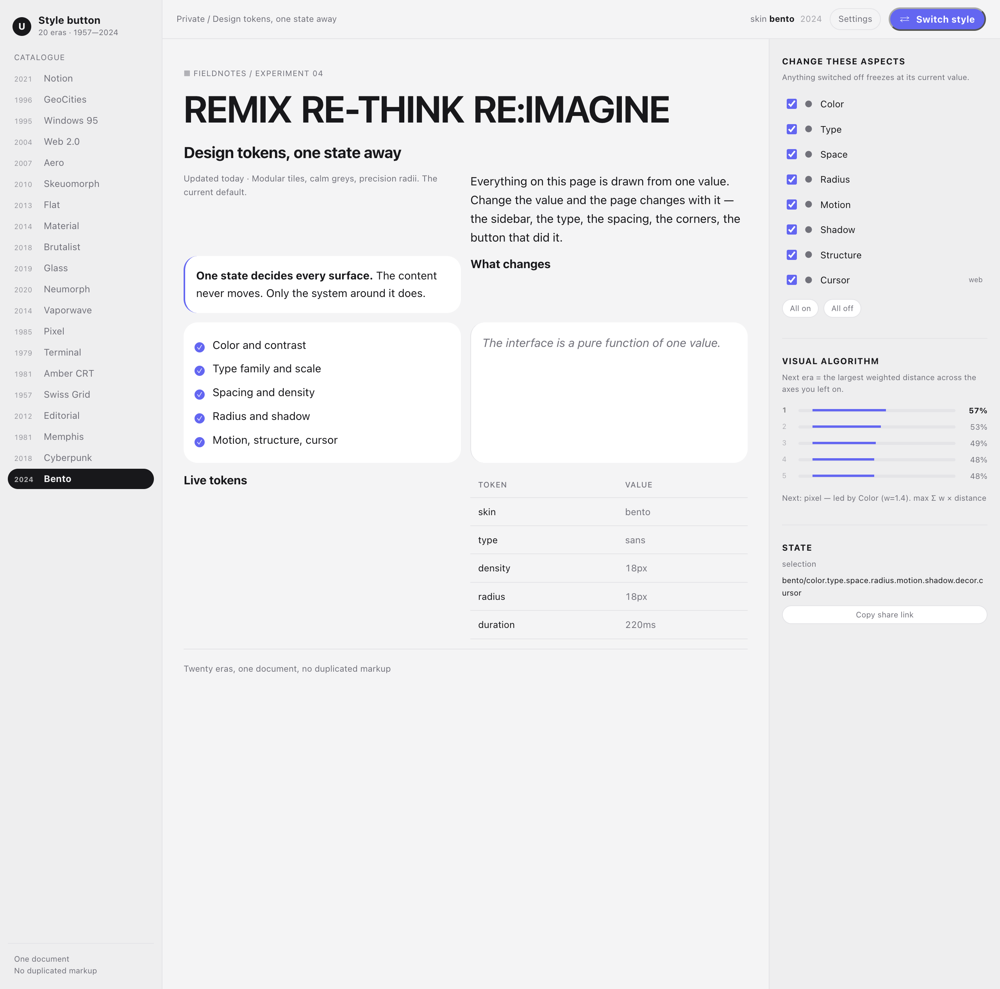

# Universal Style Button

Twenty interface eras sit behind one selection object.

**Reviewed 2026-11-27** · 2026-11-25 → 2026-11-25 · 5 commits

- **What it is** — Web and Expo showcase driven by a platform-agnostic TypeScript engine.
- **Focus** — Switch interface style without swapping markup or duplicating token tables.
- **Learning outcome** — Explore twenty eras, freeze individual axes and see the ranked next choice.
- **Innovation** — A weighted contrast score picks the next skin; switching an axis off freezes that slice at its current value.
- **Build** — one-day build, 5 commits

## Screenshots / evidence


Captured web mock; native renders the same engine through Metro.

## Run

```sh
npm run dev:web
npm run dev:ios
npm run dev:android
npm run check
npm test
npm run gen:web
```

## Details

- Eight axes: color, type, space, radius, motion, shadow, structure, cursor.
- Cursor is web-only; native shows the resolved glyph as a swatch instead.
- Web consumes `web/engine/`, emitted from `src/engine/` by `npm run gen:web`.
